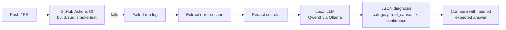

# CI Failure Remediation Agent
 
An AI agent that reads the logs of a failed CI/CD build, finds the root cause, and suggests the fix, the way an on-call engineer would triage a red pipeline.
 
> **Status: in active development.** The CI pipeline, local CI script, and LLM diagnosis agent are working; the remaining pieces are listed in the [Roadmap](#roadmap).
 
## Why
 
When a build fails, someone has to scroll through hundreds of log lines, find the real error, and work out the fix. Most failures fall into a small number of patterns (missing dependency, typo, broken Dockerfile, bad config), so a lot of this triage can be automated.
 
## How it works
 

 
1. **CI pipeline** (`.github/workflows/ci.yml`): builds the Dockerized FastAPI app, starts the container, runs a `curl` smoke test, and dumps the container logs if anything fails.
2. **Error extraction** (`agent/diagnose.py`): strips timestamps and keeps only the lines around errors and tracebacks, so the model reads signal instead of noise.
3. **Secret redaction**: GitHub tokens, API keys, and passwords are masked before the log is sent to any model.
4. **Diagnosis**: a local Qwen3 model (Ollama, temperature 0, JSON mode) returns a structured diagnosis.
5. **Evaluation**: each failure case has a labeled `expected.json`, and the agent's answer is checked against it.
## Repository layout
 
```
sample_app/            FastAPI app + Dockerfile that the pipeline builds
.github/workflows/     GitHub Actions CI pipeline
scripts/local_ci.sh    Runs the same pipeline locally in one command
agent/diagnose.py      Log extraction, redaction, and LLM diagnosis
failures/<case>/       Labeled failure cases: log.txt + expected.json
```
 
Each failure case also lives on its own branch (for example `failure/01-missing-dependency`), so the failing build can be reproduced at any time.
 
## Quick start
 
Requirements: Docker, Git Bash or any Linux shell, Python 3.11, and [Ollama](https://ollama.com) with `qwen3` pulled.
 
**Run the CI pipeline locally**
 
```bash
bash scripts/local_ci.sh          # build, run, smoke test; exit 0 = pass, 1 = fail
bash scripts/local_ci.sh 9000     # same, on a different host port
```
 
The script retries the smoke test while the app starts, stops early if the container crashes, prints the container logs on failure, and always cleans up the container.
 
**Diagnose a failed build**
 
```bash
pip install -r requirements.txt
python agent/diagnose.py failures/01_missing_dependency
```
 
Example output:
 
```json
{
  "category": "missing_dependency",
  "root_cause": "main.py imports 'requests' but it is not in requirements.txt, so it is not installed in the image.",
  "fix": "Add 'requests' to sample_app/requirements.txt",
  "confidence": 0.95
}
```
 
## Failure cases
 
| # | Case | Status |
|---|------|--------|
| 01 | Missing dependency (`import requests` not in requirements) | Done |
| 02–10 | Import typo, syntax error, port mismatch, broken Dockerfile, bad base image, bad dependency version, missing config, wrong app module, failing test | In progress |
 
## Roadmap
 
- [x] Dockerized FastAPI sample app
- [x] GitHub Actions pipeline with smoke test and log capture on failure
- [x] Local CI script (`scripts/local_ci.sh`)
- [x] Error extraction, secret redaction, structured JSON diagnosis with a local LLM
- [ ] 10 labeled failure cases and an evaluation script that reports accuracy
- [ ] Fetch failed-run logs automatically via the GitHub REST API
- [ ] JSON schema validation with retry on invalid output
- [ ] Escalate low-confidence diagnoses to a cloud LLM (Anthropic/OpenAI API)
- [ ] RAG over past failures to ground suggested fixes
- [ ] Open fix pull requests automatically (PyGithub)
- [ ] MCP server exposing the agent as tools
- [ ] Trivy container-image scan in CI
- [ ] Kubernetes deployment manifests
- [ ] pytest suite
